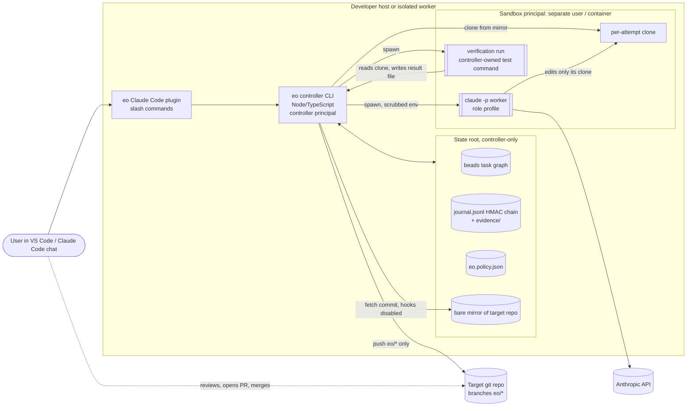
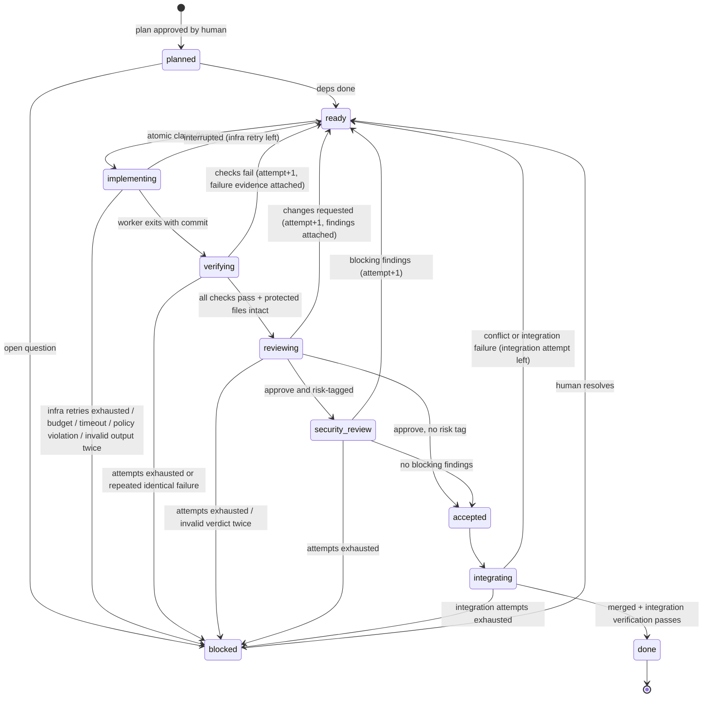

# 02 — Architecture

Working name: **eo** (Engineering Orchestrator).

## 1. Design principles

1. **Deterministic code decides; agents propose.** Every state transition, gate decision and "done" verdict is made by the controller, a normal program with tests. No agent output, summary or self-report can mark a task complete.
2. **Evidence is re-produced, not reported.** The controller re-runs verification in a fresh workspace at the submitted commit and stores hashed logs. An agent saying "tests pass" counts for nothing.
3. **Least privilege per role.** Each role gets its own tool set. Reviewers have no `Write`, `Edit` or code-running tools at all.
4. **Single writer for state.** Only the controller writes the task store, journal and evidence. They live in a **state root outside every workspace**, which agent-run code cannot write.
5. **Everything an agent reads is data.** Repository instructions, tool output, docs, failing logs and other agents' output are passed in delimited data blocks and never widen permissions.
6. **Fail closed and escalate.** On ambiguity, exhausted budget, repeated failure or policy violation, work stops and a human gets one clear escalation record.
7. **Nothing leaves the sandbox without a human.** No merges to protected branches, no deploys, no pushes outside `eo/*` branches.
8. **Agent-written code never runs as the controller.** Workers *and* verification (which executes agent-written code through the test suite) run as a separate, unprivileged principal (a separate OS user, WSL2 distro user, or container) with no write access to the state root, the controller's git directory or the policy. Without that separation, code under test could rewrite state or forge results, so principles 1, 2 and 4 would rest on the agent's goodwill.

## 2. System context



Trust boundaries are drawn in the threat model (`04-threat-model.md`).

## 3. Components

| Component | Responsibility | Notes |
|---|---|---|
| **Controller CLI (`eo`)** | Owns the state machine, scheduler, gates, budgets, journal, evidence. All commands are idempotent and resumable. | TypeScript on Node 22 (already required by Claude Code, available on Windows and Linux). Minimal runtime deps (see dependency map). |
| **State root** | Holds task store, journal, evidence, policy, HMAC key and the bare mirror of the target repo. | Outside any workspace: `%LOCALAPPDATA%\eo\<project>\` on Windows, `~/.local/state/eo/<project>/` on Linux. Writable only by the controller principal. |
| **TaskStore adapter** | Task graph, dependencies, ready queue, atomic claim, lease, heartbeat, reclaim, notes. | Beads (`bd`) by default (ADR-002), in-memory fake for unit tests, Backlog.md as fallback. Contract-tested. |
| **Journal** | Append-only `journal.jsonl` of write-ahead intent and outcome records, fsynced per record. Used for crash recovery and audit. | Each record carries an HMAC over (previous HMAC + record) using a key stored in the state root, so it cannot be rebuilt by anyone without the key. |
| **Evidence ledger** | `evidence/<task>/<attempt>/` with a `manifest.json` listing every artifact and its SHA-256; the manifest is HMAC-signed. | Logs, diffs, verdict JSON, cost records. |
| **Workspace manager** | Creates **one independent clone per attempt** (not a git worktree, because worktrees share the controller's `.git`, hooks and config) from the bare mirror; owned by the sandbox principal. | The controller brings results back with `git fetch` from the clone into the mirror, always with `-c core.hooksPath=<empty dir> -c core.fsmonitor=false`, and never reads the clone's `.git/config` or hooks. Branch naming `eo/<epic>/<task>/a<n>`. |
| **Worker runner** | Launches `claude -p` for a role, as the sandbox principal, with a generated settings file, tool set, budget, timeout and scrubbed environment; parses structured JSON output; records cost and tokens. | Also has a **scripted fake runner** for deterministic tests and failure simulation. |
| **Guard hook** | `eo hook guard` used as a `PreToolUse` hook inside workers: denies edits to protected paths and Bash commands outside the role allowlist. | Early warning only; the real gate is the post-hoc diff check (§6.3). Because invalid settings files are silently ignored, every worker run starts with a **hook canary** (a scripted denied action) and the attempt is aborted if the hook did not fire. |
| **Verifier** | Runs verification in a fresh clone at the submitted commit, as the sandbox principal, with no agent involved. | Uses the **controller-owned** test command and runner config from policy, not the repository's `package.json` scripts. Results come from a controller-supplied reporter and are cross-checked against a static test inventory (§6.3). |
| **Gate engine** | Evaluates Definition of Done from policy + evidence. Pure function, heavily unit-tested. | §6 |
| **Budget governor** | Tracks USD, input/output tokens and wall-clock per attempt, task and epic; refuses to start work that cannot fit. | Uses `--max-budget-usd` per invocation and the reported `total_cost_usd` and usage. |
| **Integration queue** | Serially merges accepted task branches into `eo/<epic>/integration` in the mirror, re-verifies after each merge, routes conflicts. | Never touches `main`. |
| **Escalation manager** | Creates escalation records, sets tasks `blocked`, surfaces them in status and through the configured notification channel. | One record per blocker, with reason, evidence and the question for the human. Unattended channel in §9. |
| **Claude Code plugin** | Slash commands, role agent definitions and the status view used from chat. | Installed per project from this repo (local `--plugin-dir` or local marketplace), not from a remote marketplace. |
| **Policy file** | `eo.policy.json`: approved repositories, protected paths, role tool profiles, Bash allowlists, test command, budgets, retry limits, concurrency, risk paths. | Stored in the state root, **not in the target repo**, so no agent commit can change it. Changed only by `eo policy edit`, which requires an interactive confirmation and records the new hash in the journal. |

## 4. Roles

Agents are short-lived `claude -p` invocations, one per step, each with a fresh context. A role is a prompt + tool profile + output schema.

| Role | Purpose | Tools | Output (`--json-schema`) |
|---|---|---|---|
| Architect | Turn an epic into a design note: components, interfaces, risks | Read, Grep, Glob | `design.json` |
| Planner | Decompose into tasks with dependencies, acceptance criteria, risk tags, open questions | Read, Grep, Glob | `plan.json` |
| Test author | Write acceptance tests for a task from its criteria, before implementation | Read, Grep, Glob, Edit, Write limited to the task's test paths; Bash limited to the controller's test command | `report.json` |
| Implementer | Make the change in its clone | Read, Grep, Glob, Edit, Write (not protected paths); Bash limited to build/test allowlist; no web tools | `report.json` |
| Reviewer | Independent code review of diff (including new tests) against criteria | Read, Grep, Glob only | `verdict.json` |
| Security reviewer | Security review of diff against a checklist, including test-harness tampering | Read, Grep, Glob only | `verdict.json` |
| Integration reviewer | Review the integrated epic diff, cross-task consistency | Read, Grep, Glob only | `verdict.json` |
| Conflict resolver | Resolve a merge conflict as a normal implementation task | Implementer profile | `report.json` |

The verifier is deliberately **not** an agent. Read-only roles are candidates for `--restricted` mode (evaluated in M2).

Independence rules enforced by the controller:
- The reviewer for an attempt is a separate invocation that never sees the implementer's transcript, only the task spec, the diff and controller-produced verification results. The implementer's self-report is shown labelled as an unverified claim.
- **Test-first is the default for every feature or bug-fix task**: the planner pairs it with a test-author task that lands first and whose test files are then protected from the implementer. The planner may mark a task `tests: existing` (e.g. pure refactor covered by existing tests) only with a reason, which the plan gate shows the human.
- Optional model diversity (e.g. reviewer on a different model than implementer) is a policy setting.

Role prompts are adapted from Oh My ClaudeCode's agent definitions (MIT, attributed), rewritten for these tool profiles and schemas.

## 5. Task lifecycle



Every loop in the diagram has a counter and a transition to `blocked`:

| Counter | Default | Counts |
|---|---|---|
| `maxAttempts` | 3 | Correction attempts (verification failure, review or security changes requested) |
| Repeated failure | 2 | Consecutive attempts with the same failure signature (normalised failing test IDs + error class) escalate early |
| `maxInfraRetries` | 2 | Worker crash, kill, hang/timeout, API error; separate from correction attempts |
| `maxInvalidOutput` | 1 re-run | Output that fails its JSON schema (plan, report, verdict) |
| `maxIntegrationAttempts` | 2 | Conflict or post-merge verification failure |
| Budget | policy | USD and tokens per attempt, task, epic |

`blocked` always carries an escalation record. Only a human command moves a task out of `blocked`.

beads statuses are coarse, so the fine-grained state lives in a controller-managed label/field on the beads issue plus the journal; the journal is authoritative when they disagree, and `eo doctor` reports any disagreement.

## 6. Quality gates and Definition of Done

### 6.1 Plan gate (before any implementation)
- `plan.json` validates against the schema; dependency graph is acyclic; every task has at least one acceptance criterion with a **machine check** (a test ID or command and expected outcome) or an explicit `review_only` flag with a reason.
- Open questions are listed; dependent tasks start `blocked: needs-clarification` instead of being guessed.
- A human approves the plan (`/eo:approve`), which records the plan hash. Unattended mode can only run already-approved plans whose hash matches.

### 6.2 Test-first gate
For each test-author task, before its tests are accepted:
- The new tests must be discovered by the controller's runner, and on the **base commit** they must fail **at assertion level** (an assertion error inside the new test IDs). Load errors, syntax errors, import failures or a crashed runner do not count as red evidence.
- Existing tests must still pass on base.
- The reviewer checks the tests against the acceptance criteria (each criterion maps to at least one test ID) before the tests are landed and protected.

### 6.3 Verification gate (controller-run, sandbox principal)
In a fresh clone at the submitted commit:
1. **Diff check.** No changes to protected paths. Protected by default: test files owned by other tasks, test runner config, `package.json` (whole file, or at least `scripts`, `dependencies`, `devDependencies`), `tsconfig*.json`, lockfiles, `.github/`, CI config, `.claude/`, `CLAUDE.md`, `.mcp.json`, `.git*` files. A task may own specific protected paths only if the approved plan says so (e.g. a dependency-adding task owns the lockfile, and is then always security-reviewed). SHA-256 of every protected file must equal the base commit's.
2. **Controller-owned test command.** The verifier calls the test runner directly from policy (e.g. `node --test --test-reporter=<controller reporter> <discovered files>`), never `npm test` or repository scripts.
3. **Inventory cross-check.** The controller statically discovers test IDs; the reported results must include exactly that set (none missing, none extra), so an early `process.exit(0)` or a suppressed suite fails the gate. Test inventory on head ⊇ base; skip/only markers not increased; assertion counts per pre-existing test not reduced (for the sample project's stack; detectors are pluggable).
4. Every machine check in the acceptance criteria passes; full suite passes; lint/typecheck pass if configured.
5. Results are stored with hashes; the exact replay command is recorded.

Residual risk: code under test runs in the same process as the reporter, so a sufficiently targeted implementation could still tamper with reported results for its own tests. Running as the sandbox principal stops it touching state; the inventory cross-check, the reviewer and the security reviewer (which looks specifically for test-harness tampering) are the remaining lines of defence. This is stated as a limitation, not hidden.

### 6.4 Review gate
- Reviewer verdict `approve` with zero `blocking` findings. Reviewer must reference each acceptance criterion by ID with a pass/fail judgement; missing criteria = invalid verdict = one re-run, then `blocked`.
- Findings use fixed categories, including `prompt-injection` (content in the repo or inputs that tries to instruct agents), which must cite the file and line.
- Security review for tasks tagged risky (touches risk paths, adds dependencies, owns a protected path, handles input parsing, auth, file system, subprocess) and always once on the integrated epic. `high`/`critical` findings block.

### 6.5 Done
A task is `done` only when the controller finds, for the merged commit: verification evidence (6.3) passing, a valid review verdict (6.4), security verdict if required, integration verification passing after merge, and an HMAC-valid evidence manifest whose hashes match the files on disk. `eo verify --task <id> --replay` re-runs the checks and must reproduce the result.

## 7. Durability and resume

- beads holds the task graph, claims and leases. The journal holds the step-by-step intent/outcome log. Evidence is on disk in the state root. Chat context holds nothing that matters.
- Each step writes an *intent* record before acting and an *outcome* record after. On `eo resume` (also run automatically at the start of `eo run`, and in read-only form by the plugin's `SessionStart` hook):
  1. Replay the journal; verify its HMAC chain.
  2. For intents without outcomes: if the worker process is gone or its lease expired, mark the attempt `interrupted`, preserve its clone for audit, call `bd reclaim`, and return the task to `ready` (counts against infra retries; exhausted → `blocked`).
  3. Verification steps are simply re-run (they are deterministic and run in a fresh clone).
  4. Integration steps are checked against git state in the mirror (is the merge commit present?) and completed or rolled back.
- The controller renews leases while a child process is alive, so a dead controller also lets leases expire.

## 8. Parallel execution

- `maxConcurrency` (default 2, max set in policy) workers at once; the scheduler only starts tasks whose dependencies are done and whose budget reservation fits.
- Each attempt has its own clone; with per-attempt sandbox users or containers, workers cannot read each other's clones. Where a single sandbox user hosts several clones (degraded T0, §9), sibling access is possible and is recorded as a limitation.
- The planner's estimated file sets are used to avoid scheduling two tasks predicted to touch the same files concurrently (soft constraint).
- Merges are serialised through the integration queue. A conflict creates a conflict-resolution attempt (implementer profile), bounded by `maxIntegrationAttempts`.

## 9. Execution tiers

| Tier | Where | Isolation | Allowed use |
|---|---|---|---|
| T0 Interactive | User's Windows PC, VS Code + Claude Code; controller runs as the user | Workers and verification run as a sandbox principal: preferably inside WSL2 or a container, otherwise a dedicated low-privilege local Windows user. Role tool profiles, `dontAsk` with allowlists, scrubbed env | Development of eo itself and the disposable sample project; other repos only if listed in the policy's approved-repository list |
| T0-degraded | Same, but no separate principal available | None beyond tool profiles | **Sample project only**, with the run report stating that principle 8 and invariants 3–5 are not enforced against a malicious agent |
| T1 Container | Linux container (Docker/WSL2 or inside the Proxmox VM) | Non-root, only the clone mounted, state root not mounted, no host credentials, egress allowlist (Anthropic API, package registry mirror) | Unattended runs on approved repos |
| T2 Proxmox worker | Dedicated unprivileged VM on an isolated VLAN, snapshot per run | Controller in the VM, workers in T1 containers inside it; VM firewall egress allowlist; credentials limited to a spend-capped API key and a deploy key that can push only `eo/*` branches of approved repos | Unattended scheduled runs; results come back as branches for human review |

The controller refuses to operate on a repository whose remote URL or path is not in the policy's `approvedRepositories` list.

Unattended mode (`eo run --unattended`) refuses to start unless: running inside T1/T2 (detected marker + policy), plan already approved with matching hash, budget caps set, and permission mode is `dontAsk` with `--permission-prompts none` (fail closed). It never uses `bypassPermissions`.

**Unattended escalation channel:** escalations are written to the state root and pushed as a status file on the `eo/<epic>/status` branch; optionally (policy, approved in M8) the controller opens a GitHub issue on the sandbox repository using a token scoped to issues only. The user sees blockers without logging into the worker.

## 10. Chat workflow (requirement 9)

Inside Claude Code (terminal or VS Code extension):

| Command | Effect |
|---|---|
| `/eo:plan <epic description>` | Architect + planner run, plan is validated and shown with open questions and cost estimate |
| `/eo:answer <question-id> <text>` | Resolve an open question; affected tasks are re-planned |
| `/eo:approve` | Approve the shown plan (records approver and plan hash) |
| `/eo:run` | Run the scheduler in the foreground until done, blocked or budget stop |
| `/eo:status` | Task table, budgets used, escalations, links to evidence |
| `/eo:resume` | Recover after interruption and continue |
| `/eo:evidence <task>` | Show the evidence manifest and replay command |

The chat session is only a front end: each command shells out to `eo` and prints its output. The chat model does not decide outcomes.

## 11. Repository layout (target)

```
src/            controller (cli, store/, runner/, gates/, budget/, journal/, integrate/, hooks/, sandbox/)
schemas/        plan, design, report, verdict, policy JSON Schemas
policy/         default policy template (copied into the state root by `eo init`)
plugin/         Claude Code plugin: commands/, agents/, hooks/
fixtures/       disposable sample project template + scenario scripts
tests/          unit/, integration/, behavioral/
infra/          container/ and proxmox/ (M8, not built until approved)
docs/           these documents, milestone reports
```
