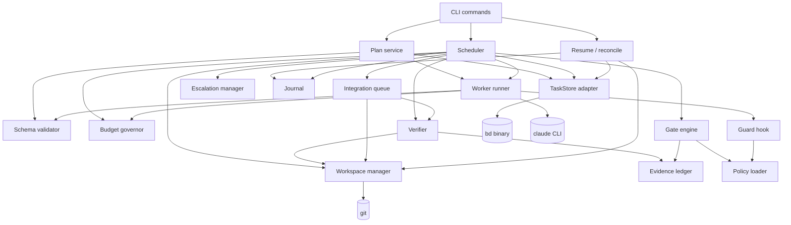
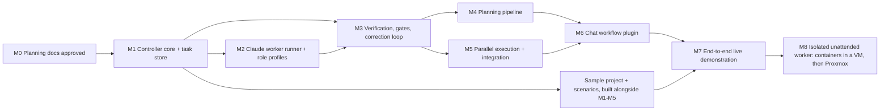

# 03 — Dependency map

## 1. External dependencies

Nothing below is installed yet. Each item is installed only after the milestone that introduces it is approved.

| Dependency | Used by | Version / pin | How obtained | Network at runtime | Notes / risk |
|---|---|---|---|---|---|
| Node.js | controller, plugin hooks | ≥ 22.x (22.22.0 observed) | Already present (Claude Code requires it) | none | |
| Claude Code CLI | worker runner, chat front end | 2.1.302 observed; minimum version recorded in `deps.lock.json` | Already present | Anthropic API | Flags are verified by M2 tests; a version check refuses to run on an untested major version |
| git | per-attempt clones, bare mirror, merges, diffs | ≥ 2.40 | Already present | none for local ops | Workers never get push credentials |
| beads (`bd`) | TaskStore | commit `9c6f6e15…` (1.3.0), binary SHA-256 recorded | `go build` from the pinned source after review; no `curl \| bash`, no npm postinstall | none (`BD_DISABLE_METRICS=1`, `DO_NOT_TRACK=1`) | CGO + embedded Dolt; Windows build is a known risk (fallback: Backlog.md adapter). Needs Go 1.26.x and a C toolchain |
| Go toolchain | building `bd` only | 1.26.7 exactly (beads `go.mod`: `go 1.26.5`, `toolchain go1.26.7`), `GOTOOLCHAIN=local` | Official archive, SHA-256 checked against go.dev's published checksum; installed after M0 approval. This container has 1.24.7, which is too old | module downloads verified by `go.sum` | Not a runtime dependency |
| ajv | JSON Schema validation of agent output and policy | exact version pinned in `package-lock.json` with integrity hashes | npm, `--ignore-scripts` | none | Only planned runtime npm dependency |
| typescript, @types/node | build | pinned | npm, `--ignore-scripts` | none | dev only |
| node:test | test runner | built in | — | — | No Jest/Mocha |
| Backlog.md | fallback TaskStore | v1.54.0 commit `75e9e97…` | only if ADR-002 fallback triggers | set `remoteOperations: false` | not installed by default |
| Docker Desktop / Podman | L1 tier; containers inside L2/PX | TBD | Docker Desktop folders seen on the PC (state unverified); install or reconfigure only after approval | egress via allowlisting proxy | No daemon in this planning container |
| Hyper-V or VirtualBox | L2 local VM | TBD after the read-only checks in `07` §1 | Both appear present on the PC; VM creation needs approval | NAT + guest firewall | Preferred local tier |
| GitHub rulesets | Staging repo ref restrictions (M8) | — | User configures; eo exports and tests them | GitHub | Free on public repos; private repos need Pro/Team/Enterprise |
| Proxmox VE | PX worker tier | TBD by user | user-provided | VLAN + firewall | M8, after approval |

Policy for all npm installs: `npm ci --ignore-scripts`, lockfile committed, no `latest` tags, `npm audit` result recorded in the milestone report.

**Not used:** Oh My ClaudeCode as an installed plugin (ADR-001; prompts adapted instead), Task Master (rejected), any remote MCP server, any telemetry SDK.

## 2. Internal component dependencies

Leaf modules (`policy`, `schema`, `journal`, `evidence`, `gates`) have no process or network side effects and are unit-tested in isolation. Everything that spawns processes sits behind an interface with a fake implementation (`FakeStore`, `FakeRunner`) so behavioural tests run deterministically and at no API cost.

## 3. Milestone dependencies

Approval points (work stops until the user says go): after M0 (before installing anything), before the first live Claude spend in each of M2, M4, M6, M7 and M8, and before any M8 infrastructure is created. The live spend caps are in `05-implementation-plan.md` §3.

## 4. Requirement traceability

| Req | Satisfied by | Proven in |
|---|---|---|
| 1 Specialist agents | Roles (§4 architecture) | M2, M4, M7 |
| 2 Durable state | beads + journal + evidence, resume | M1, M7 |
| 3 Epic decomposition with dependencies | Planner + plan gate | M4 |
| 4 Failed verification returns to implementation | Lifecycle attempts loop | M3, M7 |
| 5 Reproducible evidence | Verifier + evidence ledger + replay + test-integrity controls (holdout, canaries, mutation) | M3 (M3-6, M3-10…M3-15), M7 |
| 6 Independent review, protected gates | Reviewer independence, protected paths, diff checks | M2, M3 |
| 7 Controlled parallelism, isolated workspaces | Scheduler, per-attempt clones, isolation tiers (`07`), integration queue | M2, M5 |
| 8 Bounded retries, budgets, escalation | Attempt/infra/integration/invalid-output limits, budget governor (USD and tokens), escalation manager | M2 (M2-6), M3 (M3-3, M3-7, M3-8) |
| 9 Chat workflow | Plugin commands | M6 |
| 10 Unattended Proxmox | Tiers L2/PX, staging repository, unattended escalation channel | M8 |
| S-1 Inspect downloaded install scripts before running | Build from pinned reviewed source; `--ignore-scripts`; `GOTOOLCHAIN=local` | M1-7, M1-9 |
| S-2 Repo instructions, tool output, docs untrusted | Data blocks, tool profiles, protected `.claude/`/`CLAUDE.md`, settings isolation | M2-2, M2-5, M7-7 |
| S-3 No privileged host access or production secrets | Isolation tiers, env scrub, dedicated worker API key, no secrets in workspaces | M2-4, M2-9, M2-10 |
| S-4 Don't weaken tests, CI, security policy | Protected paths, controller-owned test command, inventory checks, policy outside repo | M3-4, M3-9, M3-13 |
| S-5 No changes to production or existing repos without approval | `approvedRepositories` policy, `eo/*`-only pushes | M1-10, M5-4 |
| S-6 No autonomous merges or deployment | No merge-to-default-branch or deploy code path; unattended pushes only to a staging repo with tested rulesets | M5-4, M8-5, M8-6 |
| D-1 Disposable sample project with planted conditions | `fixtures/tinyledger`, scenarios S1–S10 | M1–M5 behavioural suites, M7 |
| D-2 Demo: plan, delegate, find defect, correct, verify, resume | M7 | M7-1 … M7-6 |
