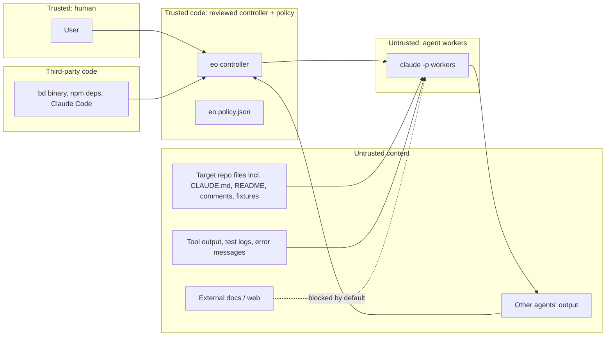

# 04 — Threat model

Method: assets → trust boundaries → threats (STRIDE-oriented, plus agent-specific threats) → mitigations → how each mitigation is tested → residual risk.

## 1. Assets

| ID | Asset | Why it matters |
|---|---|---|
| A1 | Host machine (user's Windows PC, Proxmox node) | Personal data, other repos, credentials in the home folder |
| A2 | Credentials: Claude auth, GitHub tokens/keys, any secrets in env | Spend, repo write access, account takeover |
| A3 | Target repository `main` and protected branches | Code integrity |
| A4 | Task state, journal, evidence | Integrity of "done" decisions |
| A5 | Tests, CI config, policy file | The quality gates themselves |
| A6 | Budget (API spend) | Direct cost |
| A7 | Production services | Must never be touched |

## 2. Actors and trust boundaries

The central assumption: **any agent may be fully controlled by an attacker** via prompt injection in content it reads. The design must stay safe under that assumption, so every control below is enforced by the controller, the OS, git, or Claude Code's permission system, never by an agent's good behaviour.

## 3. Threats and mitigations

| ID | Threat | Mitigation | Verified by | Residual |
|---|---|---|---|---|
| T1 | **Prompt injection in repo content** (README, code comments, CLAUDE.md, issue text) tells a worker to mark work done, delete tests, exfiltrate secrets, or run commands | Workers run inside the isolation boundary and cannot write the state root (no `bd`, journal or policy access); done is decided by the controller (§6 architecture); role tool sets; Bash allowlist; untrusted content passed in delimited data blocks; target repo's `.claude/` settings, hooks and MCP servers not loaded (`--setting-sources`/`--restricted`, `--strict-mcp-config`); `.claude/`, `CLAUDE.md`, `.mcp.json` are protected paths | Behavioural scenarios S5a–S5d (sample project) assert state, tests and files are unchanged and the injection is flagged by review | `--setting-sources` does not stop `CLAUDE.md` loading; only `--bare` does, and it also drops settings hooks and needs API-key auth. Choice measured in M2 (M2-5); until then CLAUDE.md content is assumed hostile and mitigated by the other controls |
| T2 | **Injection via tool output / failing logs** fed into the correction loop | Failure evidence trimmed, size-capped and wrapped as data; it can only influence code in the attempt clone, which is re-verified and reviewed | S5c | Same as T1 |
| T3 | **Agent weakens tests or gates** to get green (deletes/skips tests, edits CI, edits policy, edits assertions) | Protected-path hash check vs base (tests, runner config, `package.json`, `tsconfig`, lockfiles, CI); controller-owned test command; static test inventory cross-check; skip-marker and assertion-count checks; assertion-level red evidence; guard hook denies edits early; reviewer checks criteria | S3 (planted "make tests pass" temptation), unit tests of gate engine | Subtle semantic weakening of non-protected code under test is caught only by review |
| T4 | **Self-approval / review collusion**: implementer influences its own review | Reviewer is a separate invocation, read-only, sees diff + controller results, not the implementer transcript; implementer claims labelled unverified; reviewer must judge each criterion by ID | Unit test: verdict missing a criterion is rejected; scenario where implementer report lies (S4b) | Both agents may share model blind spots; optional model diversity |
| T5 | **Fabricated evidence**: agent writes fake logs or claims tests passed | Controller ignores agent-reported results; re-runs checks itself in a fresh clone; HMAC-signed manifest | S4b, replay test | See T18 for results forged by code under test |
| T6 | **Privilege escalation / host damage** from a worker or from code run by the tests (rm -rf, editing `~/.claude`, global git config, installing software, launching Windows programs) | Isolation boundary per tier (`07` §2–3): hardened container or VM, supervised pilot user only for the sample project; WSL2 never counted as a boundary; `dontAsk` permission mode with explicit allowlists; never `bypassPermissions`/`--dangerously-skip-permissions`; clone-only write paths; guard hook denies paths outside the clone | M2 tests: denied commands produce denials, not prompts; scan of runner args forbids bypass flags; M2-10 escape probes per tier | The pilot tier (separate Windows user) still shares drives with permissive ACLs, the network and localhost services; limited to the supervised sample project |
| T7 | **Credential exposure** (env vars, `.env` files, OAuth tokens in `~/.claude`, `~/.ssh`, `gh` and git credential stores, Docker credential helper) | Worker env scrubbed to an allowlist; no Windows paths mounted into containers; WSL2 interop not relied on; secrets never placed in the workspace; no production secrets anywhere; workers authenticate with a dedicated spend-limited API key, never the user's OAuth login; reviewers have no code-running tools | Test: worker sees only allowlisted env vars; M2-10 probes for `~/.claude`, `~/.ssh`, `/mnt/c` and credential helpers from inside each tier | Any credential given to a worker (its API key) must be assumed readable by the agent; its blast radius is limited by the key's spend limit |
| T8 | **Data exfiltration over network** | Web tools disabled for all roles by default; Bash allowlist excludes curl/wget/network tools; L1/L2/PX egress allowlist through a proxy (Anthropic API, package registry mirror) | M2 denial test; M2-10 and M8 egress tests from inside the boundary | In the pilot tier, allowed build/test commands could still reach the network |
| T9 | **Unbounded loops / runaway cost** | `maxAttempts`, `maxInfraRetries`, repeated-failure early stop; budget governor launches only if `spent + reserved` fits, reserving `cap + maxTurnCost` (initially `max(10 × cap, cap + $1)`); wall-clock timeout with process-tree kill; token caps; global kill switch file; provider-side Console spend limit on the worker key as backstop | M1/M3 behavioural tests with fake runner; S6 runaway agent; M2-6 governor test; M2-6b overshoot measurement | `--max-budget-usd` and `total_cost_usd` are client-side estimates, so a single invocation can exceed its cap (`07` §5). Epic-level overshoot is estimated from the M2-6b measurements (about concurrency × the largest measured single-turn cost), not guaranteed |
| T10 | **State corruption or tampering** (journal edited, truncated or restored from an older copy; crash mid-write) | Single writer; state root outside the isolation boundary and refused if others can write it; fsynced append-only journal with an HMAC chain keyed from the state root; every store task records the journal position of its last applied transition, so recovery accepts only the journaled state or the one step a crash can leave, and refuses anything else (a store, evidence or escalation file ahead of the journal) without writing, keeping a forensic record; `eo doctor` verifies chain and store agreement | Crash-injection tests (kill at every step boundary); every earlier journal of a finished run restored and refused (M1-4, M1-5) | Host owner can still edit files. **Rollback of the whole state root** (journal and store restored together to an older consistent copy) is not detected until the journal head is anchored outside the state root (**M2-0b**). Also open: `eo doctor` reads without the controller lock, so while a controller runs it can report a store ahead of the journal that is only a transition in flight (rerun it when no controller is running; M2-0b); a Beads store whose journal is emptied **and** whose initialisation marker is removed, with no evidence or escalations yet, is re-initialised (two corruptions; closed by M2-0b's checkpoint); a refusal still creates the lock file, bd's own lock and version files, and on Beads may restore the store's private bd binary. In the pilot tier the state root is protected only by NTFS ACLs against the pilot user |
| T11 | **Two workers on one task** (double claim) | beads compare-and-swap on each bead (`bd update --if-revision`); leases; controller is single writer (controller lock) | Concurrency test with 20 processes × 100 rounds on FakeStore and on real `bd` (M1-3) | The file-lock stale takeover has a known race (a contender paused > 10 s can remove a fresh lock), which could admit a second controller; a blocker for concurrent execution, fixed and verified by M5-0 |
| T12 | **Supply chain**: malicious or compromised bd/npm/OMC update | Pinned commits and hashes, build from reviewed source with `GOTOOLCHAIN=local` and `go.sum` verification, `--ignore-scripts`, no auto-update, no OMC runtime code, Task Master rejected, beads metrics disabled | Test asserts no outbound connections during a full fake-runner scenario; lockfile review | Claude Code CLI itself auto-updates unless configured; documented |
| T13 | **Merge to protected branch, unauthorised ref update, or deploy** | Controller has no command that targets the default branch; integration branch only `eo/*`; before M8 the controller holds no GitHub credentials and the user publishes `eo/*` branches; unattended pushes go only to a separate staging repository whose rulesets restrict creations, updates and deletions outside `eo/**`, block force pushes and deletions on `eo/**`, and protect tags, with no deploy-key bypass. Deploy keys cannot be branch-scoped, so no control relies on them being so. Only the controller holds the staging key; staging Actions are disabled; staging content is treated as untrusted | Test: integration refuses non-`eo/*` targets; M8-6 attempts every forbidden ref update with the controller's real staging deploy key and stores GitHub's rejections | Rulesets on private repositories need GitHub Pro/Team/Enterprise; the staging repository's admin (the user) can bypass |
| T14 | **Conflicting parallel changes** silently overwrite each other | Serial integration queue, re-verify after every merge, conflict → resolver task bounded by `maxIntegrationAttempts`, then escalation | S7 conflicting change scenario | Semantic conflicts that pass all tests |
| T15 | **Ambiguous / incomplete requirements** lead an agent to guess | Planner must output open questions; dependent tasks blocked until answered | S2 incomplete requirement scenario | Planner may miss an ambiguity; reviewer is second line |
| T16 | **Third-party tooling defaults** (findings from component evaluation: OMC skip-permissions, beads metrics, Task Master telemetry) | ADR-001, ADR-002 conditions | Network test (T12), runner argument scan (T6) | — |
| T18 | **Code under test acts with verifier privilege or forges results** (rewrites state, runs `bd`, `process.exit(0)`, monkeypatched assertions or reporter, fake result frames) | Verification inside the isolation boundary with no access to the state root; controller-owned test command; per-file process isolation with the reporter in the parent; inventory must match exactly; results streamed to the controller over a pipe; forgery canaries (naive forgery only); sentinel mutant; holdout tests; tamper scan of the diff; security reviewer checks for harness tampering (arch §6.4) | S9 and S10 sub-cases | Deliberate in-boundary forgery cannot be excluded by runtime checks; it must appear in the diff and is left to the tamper scan, security review and human PR review |
| T19 | **Git hook / config planting**: worker writes `.git/hooks/*`, `core.hooksPath`, `core.fsmonitor` that then run in the controller | Per-attempt independent clones (no shared gitdir); controller fetches with `-c core.hooksPath=<empty> -c core.fsmonitor=false` and never reads the clone's config | S9: planted hook canary must not execute | — |
| T20 | **Test command tampering**: `"test": "exit 0"`, runner config that excludes files | Controller calls the runner directly from policy; `package.json`, runner config, `tsconfig` protected | S3e | — |
| T21 | **Guard hook silently missing** because a settings file failed validation | Hook canary at the start of every worker run; attempt aborted if the canary is not denied | M2-8 | — |
| T22 | **Operating on a repo the user didn't approve** | `approvedRepositories` in the controller-side policy; controller refuses anything else | Unit test | — |
| T23 | **Relying on WSL2 as a boundary**: agent re-enables interop/automount in `wsl.conf`, runs `cmd.exe`/`powershell.exe`, reads `/mnt/c/Users/...` | WSL2 is never an isolation tier; if the controller or Docker runs in WSL2, workers still run in hardened containers with no Windows mounts | M2-10 probe from inside a worker container for `/mnt/c`, `cmd.exe`, `wsl.exe` | — |
| T24 | **Docker Desktop shared VM**: bind-mounted Windows paths, the Docker socket, or a container escape into the Docker Desktop VM that has host drives mounted | No bind mounts of Windows paths (clones via named volumes); no Docker socket in containers; non-root, `--cap-drop ALL`, `no-new-privileges`, read-only rootfs, pid/memory limits; L2 VM preferred for anything beyond attended runs | M2-10 container inspection output checked against the hardening list | Kernel or Docker Desktop vulnerabilities enabling escape |
| T25 | **Test support tampering or holdout leakage**: implementer edits helpers/fixtures/mocks so tests always pass, or learns holdout test content | Test support code protected (including modules imported by tests, by import-graph analysis); holdout tests stored only in the state root and copied only into verification clones; implementer receives only criterion ID and pass/fail; base cross-run | S10 sub-cases | Holdout tests written by the same model family as the implementer may share blind spots |
| T17 | **Instructions in this project's own docs or fixtures** being followed by an agent working on eo itself | Fixtures containing injection payloads live under `fixtures/` and are marked as such; eo development agents run with the same untrusted-content rules | Review | — |

## 4. Security invariants (each has an automated test)

1. No code path passes `--dangerously-skip-permissions`, `bypassPermissions` or equivalent to any worker.
2. Workers' environment contains only allowlisted variables.
3. Only the controller process invokes `bd`, and code inside the isolation boundary has no write access to the state root (tested by a worker and a test run that each try to write there).
4. A task cannot reach `done` without controller-produced verification evidence, a valid independent review verdict and an intact protected-file hash set.
5. Protected files are byte-identical between base and accepted head, except in tasks whose policy explicitly owns them.
6. No outbound network connection is made by the controller or `bd` during a fake-runner scenario run.
7. The integration queue never writes to a branch outside `eo/*`.
8. Attempt limits are never exceeded, and no invocation is launched once `spent + reserved` would exceed a task or epic cap; hitting a limit produces a `blocked` task with an escalation record. (Single-invocation cost overshoot is possible and is measured, not prevented: `07` §5.)
9. The controller never executes git hooks or reads git config from a workspace clone.
10. Verification never runs a repository-defined script; only the policy's test command.
11. A verification run whose forgery canaries, nonce or sentinel mutant do not behave as expected is never accepted. (This detects naive forgery; it does not prove the absence of forgery.)
12. Workers never receive the user's personal Claude or GitHub credentials.

Invariants 3–5 hold against a hostile agent in L1, L2 and PX. In the supervised pilot tier they rely on NTFS ACLs between two local users and are recorded as such in the run report.

## 5. Out of scope (stated limitations)

- A malicious host administrator.
- Vulnerabilities inside Claude Code or the Anthropic API.
- Semantic bugs that pass all tests and review (mitigated, not eliminated).
- The supervised pilot tier is not a strong sandbox; it is limited by policy to the disposable sample project with a person watching.
- Deliberate forgery code inside the boundary that defeats runtime checks (T18 residual); detected only by diff review.
- Provider-side enforcement timing of Console spend limits.
