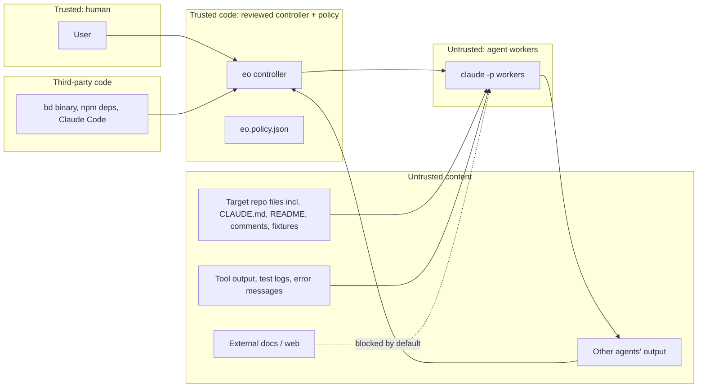

# 04 — Threat model

Method: assets → trust boundaries → threats (STRIDE-oriented, plus agent-specific threats) → mitigations → how each mitigation is tested → residual risk.

## 1. Assets

| ID | Asset | Why it matters |
|---|---|---|
| A1 | Host machine (user's Windows PC, Proxmox node) | Personal data, other repos, credentials in the home folder |
| A2 | Credentials: Claude auth, GitHub tokens/keys, any secrets in env | Spend, repo write access, account takeover |
| A3 | Target repository `main` and protected branches | Code integrity |
| A4 | Task state, journal, evidence | Integrity of "done" decisions |
| A5 | Tests, CI config, policy file | The quality gates themselves |
| A6 | Budget (API spend) | Direct cost |
| A7 | Production services | Must never be touched |

## 2. Actors and trust boundaries

The central assumption: **any agent may be fully controlled by an attacker** via prompt injection in content it reads. The design must stay safe under that assumption, so every control below is enforced by the controller, the OS, git, or Claude Code's permission system, never by an agent's good behaviour.

## 3. Threats and mitigations

| ID | Threat | Mitigation | Verified by | Residual |
|---|---|---|---|---|
| T1 | **Prompt injection in repo content** (README, code comments, CLAUDE.md, issue text) tells a worker to mark work done, delete tests, exfiltrate secrets, or run commands | Workers run as the sandbox principal and cannot write the state root (no `bd`, journal or policy access); done is decided by the controller (§6 architecture); role tool sets; Bash allowlist; untrusted content passed in delimited data blocks; target repo's `.claude/` settings, hooks and MCP servers not loaded (`--setting-sources`/`--restricted`, `--strict-mcp-config`); `.claude/`, `CLAUDE.md`, `.mcp.json` are protected paths | Behavioural scenarios S5a–S5d (sample project) assert state, tests and files are unchanged and the injection is flagged by review | `--setting-sources` does not stop `CLAUDE.md` loading; only `--bare` does, and it also drops settings hooks and needs API-key auth. Choice measured in M2 (M2-5); until then CLAUDE.md content is assumed hostile and mitigated by the other controls |
| T2 | **Injection via tool output / failing logs** fed into the correction loop | Failure evidence trimmed, size-capped and wrapped as data; it can only influence code in the attempt clone, which is re-verified and reviewed | S5c | Same as T1 |
| T3 | **Agent weakens tests or gates** to get green (deletes/skips tests, edits CI, edits policy, edits assertions) | Protected-path hash check vs base (tests, runner config, `package.json`, `tsconfig`, lockfiles, CI); controller-owned test command; static test inventory cross-check; skip-marker and assertion-count checks; assertion-level red evidence; guard hook denies edits early; reviewer checks criteria | S3 (planted "make tests pass" temptation), unit tests of gate engine | Subtle semantic weakening of non-protected code under test is caught only by review |
| T4 | **Self-approval / review collusion**: implementer influences its own review | Reviewer is a separate invocation, read-only, sees diff + controller results, not the implementer transcript; implementer claims labelled unverified; reviewer must judge each criterion by ID | Unit test: verdict missing a criterion is rejected; scenario where implementer report lies (S4b) | Both agents may share model blind spots; optional model diversity |
| T5 | **Fabricated evidence**: agent writes fake logs or claims tests passed | Controller ignores agent-reported results; re-runs checks itself in a fresh clone; HMAC-signed manifest | S4b, replay test | See T18 for results forged by code under test |
| T6 | **Privilege escalation / host damage** from a worker (rm -rf, editing `~/.claude`, global git config, installing software) | Separate sandbox principal; `dontAsk` permission mode with explicit allowlists; never `bypassPermissions`/`--dangerously-skip-permissions`; clone-only write paths; T1/T2 sandboxing for unattended; guard hook denies paths outside the clone | M2 tests: denied commands produce denials, not prompts; scan of runner args forbids bypass flags | T0 with a local low-privilege Windows user is weaker than a container; T0-degraded (no separate principal) is limited to the sample project and labelled in its report |
| T7 | **Credential exposure** (env vars, `.env` files, OAuth tokens in `~/.claude`) | Worker env scrubbed to an allowlist; secrets never placed in the workspace; no production secrets anywhere; unattended uses a dedicated spend-capped API key; reviewers have no Bash | Test: worker sees only allowlisted env vars (fake runner + one live probe in M2) | On T0 the worker uses the user's Claude login by necessity |
| T8 | **Data exfiltration over network** | Web tools disabled for all roles by default; Bash allowlist excludes curl/wget/network tools; T1/T2 egress allowlist | M2 denial test; M8 egress test from inside the sandbox | On T0, allowed build/test commands could still reach the network |
| T9 | **Unbounded loops / runaway cost** | `maxAttempts`, `maxInfraRetries`, repeated-failure early stop, per-invocation `--max-budget-usd`, task and epic USD caps checked before starting, wall-clock timeout with process-tree kill, global kill switch file | M1/M3 behavioural tests with fake runner; S6 runaway agent | Provider-side cost reporting lag; caps sized with margin |
| T10 | **State corruption or tampering** (journal edited, crash mid-write) | Single writer; state root unwritable by the sandbox principal; fsynced append-only journal with an HMAC chain keyed from the state root; `eo doctor` verifies chain and store agreement | Crash-injection tests (kill at every step boundary) | Host owner can still edit files; in T0-degraded an agent running as the same user could read the key, so integrity there is against accidents only |
| T11 | **Two workers on one task** (double claim) | beads atomic `ready --claim`; leases; controller is single writer | Concurrency test with N parallel claims | — |
| T12 | **Supply chain**: malicious or compromised bd/npm/OMC update | Pinned commits and hashes, build from reviewed source with `GOTOOLCHAIN=local` and `go.sum` verification, `--ignore-scripts`, no auto-update, no OMC runtime code, Task Master rejected, beads metrics disabled | Test asserts no outbound connections during a full fake-runner scenario; lockfile review | Claude Code CLI itself auto-updates unless configured; documented |
| T13 | **Merge to protected branch or deploy** | Controller has no command that targets `main`; integration branch only `eo/*`; unattended deploy key can push only `eo/*`; GitHub branch protection on `main` (user setting); no deploy code exists | Test: integration refuses non-`eo/*` targets; code search for deploy hooks in review | Requires user to enable branch protection on GitHub |
| T14 | **Conflicting parallel changes** silently overwrite each other | Serial integration queue, re-verify after every merge, conflict → resolver task bounded by `maxIntegrationAttempts`, then escalation | S7 conflicting change scenario | Semantic conflicts that pass all tests |
| T15 | **Ambiguous / incomplete requirements** lead an agent to guess | Planner must output open questions; dependent tasks blocked until answered | S2 incomplete requirement scenario | Planner may miss an ambiguity; reviewer is second line |
| T16 | **Third-party tooling defaults** (findings from component evaluation: OMC skip-permissions, beads metrics, Task Master telemetry) | ADR-001, ADR-002 conditions | Network test (T12), runner argument scan (T6) | — |
| T18 | **Code under test acts with verifier privilege**: implementation code imported by tests rewrites state, runs `bd`, or forges reported results (`process.exit(0)`, monkeypatched assertions) | Verification runs as the sandbox principal with no access to the state root; results via controller-owned reporter; static test inventory must match reported set exactly; security reviewer checks for harness tampering | S9 (harness tampering) sub-cases: early exit, patched assert, write to state root | A targeted forgery of its own tests' results inside the test process remains possible; stated in architecture §6.3 |
| T19 | **Git hook / config planting**: worker writes `.git/hooks/*`, `core.hooksPath`, `core.fsmonitor` that then run in the controller | Per-attempt independent clones (no shared gitdir); controller fetches with `-c core.hooksPath=<empty> -c core.fsmonitor=false` and never reads the clone's config | S9: planted hook canary must not execute | — |
| T20 | **Test command tampering**: `"test": "exit 0"`, runner config that excludes files | Controller calls the runner directly from policy; `package.json`, runner config, `tsconfig` protected | S3e | — |
| T21 | **Guard hook silently missing** because a settings file failed validation | Hook canary at the start of every worker run; attempt aborted if the canary is not denied | M2-8 | — |
| T22 | **Operating on a repo the user didn't approve** | `approvedRepositories` in the controller-side policy; controller refuses anything else | Unit test | — |
| T17 | **Instructions in this project's own docs or fixtures** being followed by an agent working on eo itself | Fixtures containing injection payloads live under `fixtures/` and are marked as such; eo development agents run with the same untrusted-content rules | Review | — |

## 4. Security invariants (each has an automated test)

1. No code path passes `--dangerously-skip-permissions`, `bypassPermissions` or equivalent to any worker.
2. Workers' environment contains only allowlisted variables.
3. Only the controller process invokes `bd`, and the sandbox principal has no write access to the state root (tested by a worker and a test run that each try to write there).
4. A task cannot reach `done` without controller-produced verification evidence, a valid independent review verdict and an intact protected-file hash set.
5. Protected files are byte-identical between base and accepted head, except in tasks whose policy explicitly owns them.
6. No outbound network connection is made by the controller or `bd` during a fake-runner scenario run.
7. The integration queue never writes to a branch outside `eo/*`.
8. Budget and attempt limits are never exceeded; exceeding one produces a `blocked` task with an escalation record.
9. The controller never executes git hooks or reads git config from a workspace clone.
10. Verification never runs a repository-defined script; only the policy's test command.

Invariants 3–5 hold only in tiers with a separate sandbox principal (T0, T1, T2), not in T0-degraded.

## 5. Out of scope (stated limitations)

- A malicious host administrator.
- Vulnerabilities inside Claude Code or the Anthropic API.
- Semantic bugs that pass all tests and review (mitigated, not eliminated).
- T0-degraded has no separate principal; it is limited by policy to the disposable sample project.
- Forgery of a test's own results by code running inside the same test process (T18 residual).
